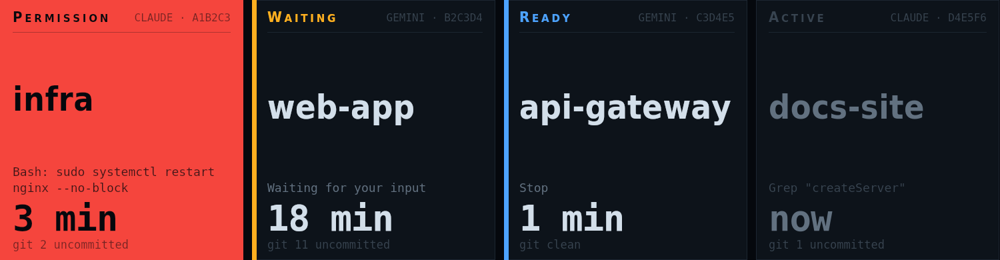

# tessera-plugin-agents

Claude Code and Gemini CLI sessions at a glance: who waits for you, for how long, and git status. Ported from aimonitor.

A plugin for [Tessera](https://github.com/Loksly/tessera), the widget mosaic for small USB LCD panels.



## Install

In Tessera, **Plugins → Install from npm** → `tessera-plugin-agents`, then restart Tessera. Or from a terminal:

```sh
npm install --prefix ~/.config/tessera/plugins tessera-plugin-agents
```

(macOS: `~/Library/Application Support/Tessera/plugins`, Windows: `%APPDATA%\Tessera\plugins`.)

## Requirements

- A hook that writes agent session files. With Claude Code, add `agent-sessions-hook` (from [`@loksly/agent-sessions`](https://github.com/Loksly/tessera/tree/main/packages/agent-sessions)) to your `settings.json` hooks; sessions land in `~/.aimonitor/sessions` by default.

## Widgets

### Agent sessions — `agents/sessions`

One tile per AI coding session. The one that needs you most turns solid, the others that wait get a colour spine, and working ones stay dark.


Uses: `agents/sessions`.

| Option | Type | Default | |
|---|---|---|---|
| `tileMin` | number | `320` | Narrowest tile. At a 374 px tall widget; scales with the height. Sessions that would need narrower tiles go to the summary column. |
| `tileMax` | number | `430` | Widest tile. So a single session doesn’t stretch across the panel. |
| `gap` | number | `12` | Gap between tiles |
| `detailLines` | number | `3` | Detail lines. Lines of the last tool call or message before cutting with an ellipsis. |
| `spineWidth` | number | `7` | Colour spine width |
| `summaryWidth` | number | `150` | Summary column width |
| `stretch` | boolean | `false` | Stretch tiles to fill the width |
| `align` | `left` \| `center` \| `right` | `"left"` | Alignment |
| `showGit` | boolean | `true` | Show uncommitted files |

### Agents summary strip — `agents/summary`

A thin header line: RAM, how many consoles are open, how many wait for you (tinted by the most urgent) and the clock.


Uses: `agents/sessions`, `system/vitals`.

| Option | Type | Default | |
|---|---|---|---|
| `ram` | boolean | `true` | Show RAM. Needs the system vitals source. |
| `clock` | boolean | `true` | Show the clock |
| `rule` | boolean | `true` | Rule underneath |

## Data sources

### AI agent sessions — `agents/sessions`

Claude Code, Gemini CLI… sessions as written by the agent-sessions hook, with git status. Options are set once in Tessera → Settings → Data sources.

| Option | Type | Default | |
|---|---|---|---|
| `dir` | string | `"~/.aimonitor/sessions"` | Sessions folder. Where the hook writes one JSON file per session. Empty: $AGENT_SESSIONS_DIR or ~/.aimonitor/sessions. |
| `git` | boolean | `true` | Read git status. Repository name and uncommitted files of each session (runs git). |
| `zombieMs` | duration (ms) | `900000` | Drop silent working sessions after. A session that says it is working and writes nothing for this long is dead. |
| `staleMs` | duration (ms) | `7200000` | Drop any silent session after. The net under SessionEnd, which never arrives if the terminal is killed. Raise it if you leave permission prompts waiting for hours. |
| `reap` | boolean | `true` | Delete files of dead sessions. Safe: a live session writes its file again on its next event. |
| `debounceMs` | duration (ms) | `200` | Wait for a burst of events |
| `pollMs` | duration (ms) | `30000` | Re-read every. Fallback to file watching; also refreshes the git counts. |

## Interludes

### 8-bit runner — `agents/runner`

A side-scrolling platformer run through a server room, in flat colours. Every slot plays a different ending; now and then the runner ships the release. Add it in Tessera → Screens → Interludes.

| Option | Type | Default | |
|---|---|---|---|
| `title` | string | `"TESSERA"` | Name in the score. Letters, digits and - . ! ? |

## Development

```sh
npm install
npm test          # node:test
npm run check     # TypeScript
npm run build     # dist/index.js, what Tessera loads
```

To try it in a running Tessera without publishing: `tessera plugins link .` and restart Tessera.

Working on Tessera and its plugins together: clone them side by side
(`tessera/` and `tessera-plugins/tessera-plugin-agents/`) and run `npm install` in
`tessera/`; its workspaces link every plugin found in `../tessera-plugins`.

## License

MIT
