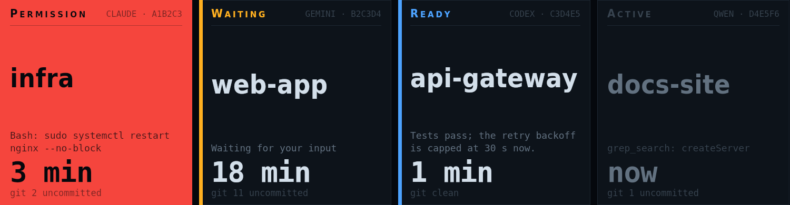

# kiosko-plugin-agents

Your AI coding agents at a glance (Claude Code, Gemini CLI, Qwen Code, Codex CLI, OpenCode, Kimi CLI, iFlow CLI…, also with local models): who waits for you, for how long, and git status. Ported from aimonitor.

A plugin for [Kiosko](https://github.com/kiosko-lcd/kiosko), the widget mosaic for small USB LCD panels.



## Install

In Kiosko, **Plugins → Install from npm** → `kiosko-plugin-agents`, then restart Kiosko. Or from a terminal:

```sh
npm install --prefix ~/.config/kiosko/plugins kiosko-plugin-agents
```

(macOS: `~/Library/Application Support/Kiosko/plugins`, Windows: `%APPDATA%\Kiosko\plugins`.)

## Requirements

- A hook that writes agent session files. With Claude Code, add `agent-sessions-hook` (from [`@loksly/agent-sessions`](https://github.com/kiosko-lcd/kiosko/tree/main/packages/agent-sessions)) to your `settings.json` hooks; sessions land in `~/.aimonitor/sessions` by default.

## What it does on your machine

- **Runs**: `git`.
- **Reads**: `~/.aimonitor/sessions`, `~/.codex/sessions`, `~/.qwen/projects`, `~/.kimi/sessions`, `~/.kimi/kimi.json`, `~/.config/kiosko/agents`.

- Uses `system/vitals` from [kiosko-plugin-system](../kiosko-plugin-system) when it is there.

## Widgets

### Agent sessions — `agents/sessions`

One tile per AI coding session. The one that needs you most turns solid, the others that wait get a colour spine, and working ones stay dark.


Uses: `agents/sessions`.

| Option | Type | Default | |
|---|---|---|---|
| `projects` | list | `[]` | Projects. Empty: all. Project, repository or folder names or patterns, comma-separated: * matches anything, a leading ! leaves out (web-app, acme-*, !scratch). |
| `hideStates` | list | `[]` | Hide sessions that are. E.g. Active and Idle, to see only the ones that claim you. |
| `maxTiles` | number | `0` | Most tiles. 0 = as many as fit. The rest go to the summary column, so the tiles get wider. |
| `tileMin` | number | `320` | Narrowest tile. At a 374 px tall widget; scales with the height. Sessions that would need narrower tiles go to the summary column. |
| `tileMax` | number | `430` | Widest tile. So a single session doesn’t stretch across the panel. 0 = no limit: the tiles fill the width. |
| `gap` | number | `12` | Gap between tiles |
| `detailLines` | number | `3` | Detail lines. Lines of the last tool call or message before cutting with an ellipsis. 0 hides it. |
| `spineWidth` | number | `7` | Colour spine width |
| `summaryWidth` | number | `150` | Summary column width |
| `align` | `left` \| `center` \| `right` | `"left"` | Alignment |
| `showGit` | boolean | `true` | Show uncommitted files |
| `showId` | boolean | `true` | Show the console id. PROVIDER · ABC123 in the corner, to tell two consoles of one project apart. |

### Agents summary strip — `agents/summary`

A thin header line: RAM, how many consoles are open, how many wait for you (tinted by the most urgent) and the clock.


Uses: `agents/sessions`, `system/vitals`.

| Option | Type | Default | |
|---|---|---|---|
| `projects` | list | `[]` | Projects. Empty: all. Project, repository or folder names or patterns, comma-separated: * matches anything, a leading ! leaves out (web-app, acme-*, !scratch). |
| `showRam` | boolean | `true` | Show RAM. Needs the system vitals source. |
| `showConsoles` | boolean | `true` | Show how many consoles. Off: only how many wait for you, for short strips. |
| `showClock` | boolean | `true` | Show the clock |
| `showRule` | boolean | `true` | Rule underneath |

## Data sources

### AI agent sessions — `agents/sessions`

Sessions of Claude Code, Gemini CLI, Qwen Code, Codex CLI, Kimi CLI… from the agent-sessions hook, from the agents’ own logs and from status files, with git status. Options are set once in Kiosko → Settings → Data sources.

| Option | Type | Default | |
|---|---|---|---|
| `dir` | string | `"~/.aimonitor/sessions"` | Sessions folder. Where the hook writes one JSON file per session. Empty: $AGENT_SESSIONS_DIR or ~/.aimonitor/sessions. |
| `git` | boolean | `true` | Read git status. Repository name and uncommitted files of each session (runs git). |
| `zombieMs` | duration (ms) | `900000` | Drop silent working sessions after. A session that says it is working and writes nothing for this long is dead. The cats room turns it into Schrödinger's box at half of this. |
| `staleMs` | duration (ms) | `7200000` | Drop any silent session after. The net under SessionEnd, which never arrives if the terminal is killed. Raise it if you leave permission prompts waiting for hours. |
| `reap` | boolean | `true` | Delete files of dead sessions. Safe: a live session writes its file again on its next event. |
| `debounceMs` | duration (ms) | `200` | Wait for a burst of events |
| `pollMs` | duration (ms) | `30000` | Re-read every. Fallback to file watching; also refreshes the git counts. |
| `codex` | boolean | `true` | Read Codex CLI sessions. From its own logs in ~/.codex/sessions, if that folder exists; no hook needed. Working and done only: for permission prompts, add the hook (see the README). |
| `codexDir` | string | `""` | Codex folder. Empty: $CODEX_HOME or ~/.codex. |
| `qwen` | boolean | `true` | Read Qwen Code sessions. From its own chat logs in ~/.qwen/projects, if that folder exists; no hook needed. Working and done only: for permission prompts, add the hook (see the README). |
| `qwenDir` | string | `""` | Qwen Code folder. Empty: $QWEN_RUNTIME_DIR or ~/.qwen. |
| `kimi` | boolean | `true` | Read Kimi CLI sessions. From its own logs in ~/.kimi/sessions, if that folder exists; no hook needed. In the interactive shell permission prompts are not logged: add the hook for those (see the README). |
| `kimiDir` | string | `""` | Kimi folder. Empty: $KIMI_SHARE_DIR or ~/.kimi. |
| `statusFiles` | boolean | `true` | Read status files. Tiny JSON files that any agent’s hooks or your own scripts write, one per session, in ~/.config/kiosko/agents (OpenCode’s plugin, for one). See the README for the format. |
| `statusDir` | string | `""` | Status files folder. Empty: $KIOSKO_AGENTS_STATUS_DIR or ~/.config/kiosko/agents. |
| `fileStaleMs` | duration (ms) | `1800000` | Forget a quiet log after. An agent read from its own log can’t say you closed it: a finished session stays this long. |
| `filePollMs` | duration (ms) | `3000` | Look at the agents’ logs every |

## Interludes

### 8-bit runner — `agents/runner`

A side-scrolling platformer run through a server room, in flat colours. Every slot plays a different ending; now and then the runner ships the release. Add it in Kiosko → Screens → Interludes.

| Option | Type | Default | |
|---|---|---|---|
| `title` | string | `"KIOSKO"` | Name in the score. Letters, digits and - . ! ? |

## Supported agents

Each session is one tile (and one cat in the [cats room](../kiosko-plugin-cats)). What matters most is
**"waiting for you"**: a permission prompt or a question. Some agents only say that through their hooks,
so each one can be read in up to two ways: from **its own files** (nothing to set up) or through
**its hooks** (one line of config, and then it can also tell a permission prompt). When both report the
same session, the hook wins.

| Agent | Own files, no setup | Hooks | Waiting for your permission |
|---|---|---|---|
| Claude Code | — | `agent-sessions-hook` | yes (hook) |
| Gemini CLI | — | `agent-sessions-hook --provider gemini` | yes (hook) |
| **Qwen Code** (also with local OpenAI-compatible models) | `~/.qwen/projects/*/chats/*.jsonl`: working / done | `agent-sessions-hook --provider qwen` | yes, with the hook |
| **Codex CLI** (also `--oss` / Ollama) | `~/.codex/sessions/YYYY/MM/DD/rollout-*.jsonl`: working / done / interrupted | `agent-sessions-hook --provider codex` | yes, with the hook |
| **Kimi CLI** | `~/.kimi/sessions/*/*/wire.jsonl`: working / done / question, and permission when it is logged | `agent-sessions-hook --provider kimi` | yes, with the hook |
| **iFlow CLI** | — | the script in [`docs/hooks/iflow-kiosko.sh`](docs/hooks/iflow-kiosko.sh) | yes, on its permission notification |
| **OpenCode** (often with local models) | — | the plugin in [`docs/hooks/opencode-kiosko.js`](docs/hooks/opencode-kiosko.js) | yes (`permission.asked`) |
| Anything else | — | a status file (below) | if you write it |

Every reader can be turned off in Kiosko → Settings → Data sources → *AI agent sessions*; one whose
folder doesn't exist reads nothing. Nothing outside those folders is opened, nothing is written to them,
and only logs written in the last 30 minutes (*Forget a quiet log after*) are read, a few kilobytes from
their end. A session read from its log can't say you closed the agent: a finished one stays until then
(Qwen Code also leaves a `.runtime.json` with its PID, so a closed Qwen session goes away at once).

Where those formats come from (the readers' source comments say exactly which files):
[openai/codex](https://github.com/openai/codex) (`codex-rs/rollout`, `codex-rs/protocol`, `codex-rs/hooks`),
[QwenLM/qwen-code](https://github.com/QwenLM/qwen-code) (`packages/core/src/services/chatRecordingService.ts`,
[hooks](https://github.com/QwenLM/qwen-code/blob/main/docs/users/features/hooks.md)),
[MoonshotAI/kimi-cli](https://github.com/MoonshotAI/kimi-cli) ([data locations](https://github.com/MoonshotAI/kimi-cli/blob/main/docs/en/configuration/data-locations.md),
[hooks](https://github.com/MoonshotAI/kimi-cli/blob/main/docs/en/customization/hooks.md)),
[iflow-ai/iflow-cli](https://github.com/iflow-ai/iflow-cli/blob/main/docs_en/examples/hooks.md) and
[OpenCode plugins](https://opencode.ai/docs/plugins/).

### Hooks

Install the hook once: `npm install -g @loksly/agent-sessions`. It writes one file per session to
`~/.aimonitor/sessions`, never fails loudly and needs no network.

**Qwen Code**: the same `hooks` block as Claude Code, in `~/.qwen/settings.json`, with
`--provider qwen`:

```json
{
  "hooks": {
    "SessionStart":      [{ "hooks": [{ "type": "command", "command": "agent-sessions-hook --provider qwen", "timeout": 5 }] }],
    "UserPromptSubmit":  [{ "hooks": [{ "type": "command", "command": "agent-sessions-hook --provider qwen", "timeout": 5 }] }],
    "PreToolUse":        [{ "hooks": [{ "type": "command", "command": "agent-sessions-hook --provider qwen", "timeout": 5 }] }],
    "PostToolUse":       [{ "hooks": [{ "type": "command", "command": "agent-sessions-hook --provider qwen", "timeout": 5 }] }],
    "PermissionRequest": [{ "hooks": [{ "type": "command", "command": "agent-sessions-hook --provider qwen", "timeout": 5 }] }],
    "Notification":      [{ "hooks": [{ "type": "command", "command": "agent-sessions-hook --provider qwen", "timeout": 5 }] }],
    "Stop":              [{ "hooks": [{ "type": "command", "command": "agent-sessions-hook --provider qwen", "timeout": 5 }] }],
    "SessionEnd":        [{ "hooks": [{ "type": "command", "command": "agent-sessions-hook --provider qwen", "timeout": 5 }] }]
  }
}
```

**iFlow CLI** hands the session to hooks in environment variables rather than on stdin, so it gets a
small script instead: copy [`docs/hooks/iflow-kiosko.sh`](docs/hooks/iflow-kiosko.sh) somewhere on your
`PATH` and, in `~/.iflow/settings.json`:

```json
{
  "hooks": {
    "UserPromptSubmit": [{ "hooks": [{ "type": "command", "command": "iflow-kiosko.sh working" }] }],
    "PreToolUse":       [{ "matcher": ".*", "hooks": [{ "type": "command", "command": "iflow-kiosko.sh working" }] }],
    "Notification":     [{ "matcher": ".*permission.*", "hooks": [{ "type": "command", "command": "iflow-kiosko.sh permission" }] }],
    "Stop":             [{ "hooks": [{ "type": "command", "command": "iflow-kiosko.sh done" }] }],
    "SessionEnd":       [{ "hooks": [{ "type": "command", "command": "iflow-kiosko.sh end" }] }]
  }
}
```

**Codex CLI**: `~/.codex/hooks.json`, the same shape (`SessionStart`, `UserPromptSubmit`, `PreToolUse`,
`PermissionRequest`, `PostToolUse`, `Stop`, `SessionEnd`) with `agent-sessions-hook --provider codex`.
Codex has no `Notification` event: `PermissionRequest` is what tells a permission prompt. New hooks must be
trusted before they run: open `/hooks` in Codex and trust them.

**Kimi CLI**: `~/.kimi/config.toml`, one `[[hooks]]` per event:

```toml
[[hooks]]
event = "Notification"
command = "agent-sessions-hook --provider kimi"
timeout = 5

[[hooks]]
event = "PreToolUse"
command = "agent-sessions-hook --provider kimi"
timeout = 5

# … and the same for UserPromptSubmit, PostToolUse, Stop, SessionStart and SessionEnd.
```

**OpenCode**: copy [`docs/hooks/opencode-kiosko.js`](docs/hooks/opencode-kiosko.js) to
`~/.config/opencode/plugins/`. It writes status files (below) on `session.status`, `session.idle`,
`permission.asked` and `question.asked`, and deletes them on `session.deleted`.

### Status files: any agent, any script

For an agent this plugin doesn't know, or your own script: write one small JSON file per session to
`~/.config/kiosko/agents/` (or `$KIOSKO_AGENTS_STATUS_DIR`), and delete it when the session ends.

```json
{ "agent": "my-agent", "id": "42", "state": "permission", "cwd": "/home/me/web-app", "detail": "bash: npm publish" }
```

- `agent` (required): a short name, letters, digits, `.`, `_`, `-`; it shows in the tile's corner.
- `state` (required): `working`, `permission`, `input` (a question or your turn), `done` or `idle`.
- `id`: defaults to the file name. `cwd`: absolute, for the project name and git status. `detail`: one line.
- `updated` / `since` (ms epoch or ISO): default to the file's modification time; a silent file is dropped
  like any session.

From a shell hook, for example:

```sh
printf '{"agent":"my-agent","id":"%s","state":"%s","cwd":"%s"}' "$SESSION" "$STATE" "$PWD" \
  > ~/.config/kiosko/agents/my-agent-$SESSION.json
```

It's read defensively: regular files only (no symlinks), at most 16 KiB each and 200 in the folder, text cut
to one line and secrets redacted. There is no network listener: a file is the whole interface.

## Development

```sh
npm install
npm test          # node:test
npm run check     # TypeScript
npm run build     # dist/index.js, what Kiosko loads
```

To try it in a running Kiosko without publishing: `kiosko plugins link .` and restart Kiosko.

Working on Kiosko and its plugins together: clone them side by side
(`kiosko/` and `kiosko-plugins/kiosko-plugin-agents/`) and run `npm install` in
`kiosko/`; its workspaces link every plugin found in `../kiosko-plugins`.

## License

MIT
